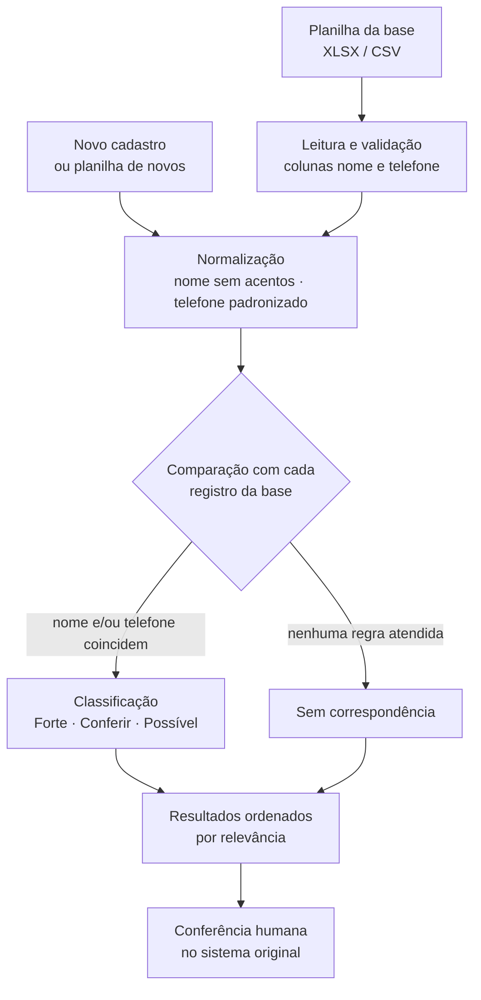

<div align="center">

# 🔎 Validador de Alunos

**Pare de cadastrar o mesmo aluno duas vezes.**
Aplicativo desktop que confere, a partir de planilhas, se um cadastro já existe antes de ele entrar no sistema, seja um por vez ou centenas de uma só vez.


</div>

---

## 📑 Sumário

- [Sobre o projeto](#-sobre-o-projeto)
- [Origem do projeto](#-origem-do-projeto)
- [Funcionalidades](#-funcionalidades)
- [Como funciona](#-como-funciona)
- [Requisitos](#-requisitos)
- [Instalação](#-instalação)
- [Como usar](#-como-usar)
- [Formato das planilhas](#-formato-das-planilhas)
- [Regras de comparação](#-regras-de-comparação)
- [Padronização de dados](#-padronização-de-dados)
- [Configuração](#-configuração)
- [Logs](#-logs)
- [Estrutura do projeto](#-estrutura-do-projeto)
- [Gerar executável](#-gerar-executável-opcional)
- [Segurança e privacidade](#-segurança-e-privacidade)
- [Solução de problemas](#-solução-de-problemas)
- [Limitações](#-limitações)
- [Melhorias futuras](#-melhorias-futuras)
- [Autor](#-autor)

---

## 📌 Sobre o projeto

O **Validador de Alunos** é uma ferramenta independente que ajuda a evitar **cadastros duplicados**. Ele usa como referência uma planilha (XLSX ou CSV) exportada do sistema da instituição e compara os dados de um novo cadastro com tudo o que já existe, apontando correspondências exatas e também aproximadas, como nomes com acento diferente, palavras em outra ordem, nomes incompletos ou telefones escritos em formatos distintos.

O programa funciona em dois modos:

1. **Pesquisa individual:** informe nome e telefone e veja na hora se já existe algo parecido na base.
2. **Comparação de duas planilhas:** carregue a base e uma planilha de novos cadastros e receba, em uma única execução, a lista de quais cadastros **já existem**, quais **não foram encontrados** e quais **não puderam ser verificados**.

> O programa **não acessa o sistema original**, **não acessa seu banco de dados** e **não grava nada nas planilhas**. Ele apenas lê os arquivos e apresenta sugestões para conferência.

---

## 💡 Origem do projeto

Este projeto foi **idealizado, desenvolvido e implantado por mim na empresa onde trabalho**.

Tudo começou quando percebi uma **falha na verificação de duplicidade** do sistema que a empresa já utilizava: era possível cadastrar a mesma pessoa mais de uma vez sem qualquer alerta, e o sistema também **não oferecia**:

- uma busca tolerante a variações de nome (acentos, ordem das palavras, nome parcial);
- a comparação de telefones em formatos diferentes (com ou sem DDD, com ou sem o 9 na frente, com `+55`, etc.);
- a conferência de **vários cadastros de uma vez** contra a base existente.

Em vez de aceitar o retrabalho manual, construí o Validador como uma solução complementar, **sem alterar o sistema existente**, e ele foi **implementado e passou a ser usado no dia a dia da empresa**, tornando a conferência de novos cadastros mais rápida, padronizada e confiável.

---

## ✨ Funcionalidades

### Pesquisa individual
- Busca por **nome e telefone** com resultado imediato (tecla **Enter** ou botão *Verificar duplicidade*).
- Resultados **classificados por relevância** (*Forte*, *Conferir*, *Possível*) e **coloridos** para leitura rápida.
- Indicação da **linha da planilha** onde o cadastro foi encontrado, facilitando a conferência no sistema original.
- Pesquisa por **partes do nome** (ex.: "Maria Silva" encontra "Maria Oliveira Silva").

### Comparação de duas planilhas
- Compara uma **planilha de novos cadastros** com a **base existente** de uma só vez.
- Retorno único, organizado em três abas:
  - **Já existentes:** cadastros novos que têm correspondência na base, com os dados lado a lado (linha, nome e telefone dos dois lados), o motivo e a classificação.
  - **Não encontrados:** cadastros sem nenhuma correspondência, ou seja, aptos a serem cadastrados após conferência.
  - **Não verificados:** linhas com nome ou telefone ausente/inválido, com o motivo informado.
- Resumo automático com totais e cor de alerta (vermelho quando há duplicidades, verde quando não há).
- Reaproveita a base já carregada na janela principal e os mesmos ajustes de DDD e similaridade.

### Qualidade e praticidade
- Aceita **XLSX** e **CSV** (separador detectado automaticamente, com suporte a UTF-8 com BOM).
- Cabeçalhos **não diferenciam maiúsculas de minúsculas** (`Nome`, `NOME`, `nome`).
- **Reabre automaticamente a última base usada.**
- **Recarrega a base sozinha** se o arquivo tiver sido substituído ou salvo novamente desde a última leitura.
- **Alerta de base desatualizada** quando a planilha tem 7 dias ou mais.
- Mensagens de erro claras (por exemplo, quando a planilha está aberta no Excel).
- **Log técnico** sem dados pessoais.

---

## ⚙️ Como funciona



A comparação de planilhas reaproveita **exatamente a mesma lógica** da pesquisa individual para cada linha, garantindo que os dois modos sempre apresentem resultados consistentes.

---

## 📋 Requisitos

| Item | Detalhe |
|---|---|
| **Python** | 3.9 ou superior |
| **Sistema operacional** | Windows (recomendado), Linux ou macOS |
| **Interface gráfica** | `tkinter` (já incluído no Python para Windows; no Linux instale `python3-tk`) |
| **Bibliotecas** | `pandas`, `openpyxl`, `rapidfuzz` (listadas em `requirements.txt`) |

| Biblioteca | Para que serve |
|---|---|
| [`pandas`](https://pandas.pydata.org/) | Leitura e manipulação das planilhas |
| [`openpyxl`](https://openpyxl.readthedocs.io/) | Leitura de arquivos `.xlsx` |
| [`rapidfuzz`](https://github.com/rapidfuzz/RapidFuzz) | Cálculo de similaridade entre nomes |

---

## 🚀 Instalação

### Windows

```bash
# 1. Clone o repositório
git clone https://github.com/brayannick/<nome-do-repositorio>.git
cd <nome-do-repositorio>

# 2. Crie e ative o ambiente virtual
python -m venv .venv
.venv\Scripts\activate

# 3. Instale as dependências
python -m pip install -r requirements.txt

# 4. Execute
python main.py
```

### Linux / macOS

```bash
python3 -m venv .venv
source .venv/bin/activate
python -m pip install -r requirements.txt
python main.py
```

> No Linux, pode ser necessário instalar o pacote do Tkinter: `sudo apt install python3-tk`.

---

## 🖥️ Como usar

### Pesquisa individual

1. Clique em **Selecionar planilha** e escolha a base de cadastros existentes (a última base usada é reaberta automaticamente nas próximas execuções).
2. Informe o **nome** e o **telefone** do novo cadastro.
3. Clique em **Verificar duplicidade** (ou tecle **Enter**).
4. Analise a tabela de resultados e **confira no sistema original** antes de cadastrar.
5. Use **Limpar** para uma nova consulta e **Atualizar base** para reler o arquivo manualmente.

### Comparar duas planilhas

1. Na janela principal, clique em **Comparar duas planilhas...**
2. Selecione a **base (cadastros existentes)**. Se já houver uma base carregada, ela é sugerida automaticamente.
3. Selecione a planilha de **novos cadastros a verificar**.
4. Clique em **Comparar planilhas**.
5. Analise as abas:

| Aba | O que mostra |
|---|---|
| **Já existentes (n)** | Cadastros novos com correspondência na base, com dados dos dois lados, motivo e classificação |
| **Não encontrados (n)** | Cadastros sem correspondência pelas regras atuais |
| **Não verificados (n)** | Linhas com nome ou telefone ausente/inválido, com o motivo |

> A comparação usa o **DDD padrão** e a **similaridade mínima** definidos na janela principal.

---

## 📄 Formato das planilhas

- Formatos aceitos: **`.xlsx`** e **`.csv`**.
- Colunas **obrigatórias**: **`nome`** e **`telefone`** (maiúsculas e minúsculas não importam). Outras colunas são ignoradas.
- A coluna **Linha** nos resultados corresponde à linha real da planilha (cabeçalho = linha 1), o que facilita localizar o cadastro.
- Linhas totalmente vazias são descartadas.

Exemplo:

| nome | telefone |
|---|---|
| Maria Oliveira Silva | (88) 99999-0000 |
| João Pereira | 88 98888-1111 |

Um exemplo fictício está em [`dados/alunos_exemplo.csv`](dados/alunos_exemplo.csv). **Não use dados reais em demonstrações.**

---

## 🧠 Regras de comparação

Cada cadastro novo é comparado com todos os registros da base. Quando alguma regra é atendida, o resultado recebe uma classificação:

| Classificação | Quando aparece |
|---|---|
| 🔴 **Forte** | Nome **e** telefone coincidem; **ou** telefone coincide e o nome é semelhante (ou está contido no outro) |
| 🟡 **Conferir** | **Só** o telefone coincide (pode ser número compartilhado, como o de um responsável); **ou só** o nome coincide |
| ⚪ **Possível** | Nome semelhante (acima do limite de similaridade) **ou** nome contido em outro cadastro |

Os resultados são ordenados por **classificação** e, dentro dela, pela **similaridade do nome**, de modo que as correspondências mais relevantes aparecem primeiro.

### Como o nome é comparado

- **Similaridade:** usa o maior valor entre a comparação direta e a comparação que **ignora a ordem das palavras** (`Silva Ana` ≈ `Ana Silva`), via RapidFuzz.
- **Nome contido:** todas as palavras do nome menor aparecem no maior (mínimo de 2 palavras). Ex.: `Maria Silva` em `Maria Oliveira Silva`.
- **Limite de similaridade:** ajustável na tela, de **60% a 100%**.

---

## 🧹 Padronização de dados

### Nomes
Antes de comparar, o nome passa por: conversão para minúsculas, **remoção de acentos** e **colapso de espaços repetidos**. Assim, `JOSÉ  da   Silva` e `jose da silva` são tratados como iguais.

### Telefones
O telefone é padronizado em `(DDD, número)`:

- remove símbolos, espaços e qualquer caractere que não seja dígito;
- remove o prefixo internacional `00` e o código do país `55`;
- remove o zero antes do DDD (`088...`);
- se vier **sem DDD** (8 ou 9 dígitos), aplica o **DDD padrão** configurado na tela (inicial `88`);
- exige **pelo menos 8 dígitos** para considerar o número válido.

| Entrada | Resultado |
|---|---|
| `(88) 99999-1234` | DDD `88` · número `999991234` |
| `+55 88 99999-1234` | DDD `88` · número `999991234` |
| `088 99999-1234` | DDD `88` · número `999991234` |
| `99999-1234` | DDD padrão · número `999991234` |
| `9999-1234` | DDD padrão · número `99991234` |

**Regra de coincidência:** a comparação usa os **8 últimos dígitos**, então o número antigo de 8 dígitos coincide com a versão atual de 9 dígitos. Se os dois telefones tiverem DDD, ele também precisa ser igual.

---

## 🔧 Configuração

Os ajustes ficam na tela principal e são salvos automaticamente em `config.json`, ao lado do programa:

| Campo | Descrição | Padrão |
|---|---|---|
| `ddd_padrao` | DDD aplicado a telefones sem DDD | `88` |
| `limiar` | Similaridade mínima de nomes (%) | `86` |
| `ultima_base` | Caminho da última planilha usada (reaberta ao iniciar) | gerado automaticamente |

Exemplo de `config.json`:

```json
{
  "ddd_padrao": "88",
  "ultima_base": "C:/caminho/para/base.xlsx",
  "limiar": 86
}
```

> 💡 **Sobre o limite de similaridade:** valores mais altos reduzem falsos positivos, mas podem deixar passar variações de grafia. Valores mais baixos encontram mais possibilidades, com mais resultados para conferir. Ajuste após testar com dados representativos.

Constantes no início do `main.py` também podem ser alteradas:

| Constante | Função | Padrão |
|---|---|---|
| `DDD_PADRAO` | DDD inicial | `"88"` |
| `LIMIAR_PADRAO` | Similaridade inicial (%) | `86` |
| `DIAS_ALERTA_BASE` | Dias para avisar que a planilha está antiga | `7` |

---

## 🗒️ Logs

O arquivo `validador.log` registra **apenas eventos técnicos**: quantidade de registros carregados, quantidade de correspondências e erros, **nunca nomes ou telefones**.

```
INFO Base carregada: 1084 registros
INFO Verificação concluída: 3 correspondências
INFO Comparação de planilhas: 49 novos, 8 existentes, 41 sem correspondência, 0 não verificados
```

---

## 📁 Estrutura do projeto

```
.
├── main.py              # Aplicação completa (regras de negócio + interface)
├── requirements.txt     # Dependências
├── README.md            # Esta documentação
├── dados/
│   └── alunos_exemplo.csv   # Planilha fictícia para testes
├── config.json          # Gerado automaticamente (ajustes do usuário)
└── validador.log        # Gerado automaticamente (log técnico)
```

Organização interna do `main.py`:

| Seção | Responsabilidade |
|---|---|
| **0. Configurações** | Constantes, caminhos, log, leitura/gravação do `config.json` |
| **1. Normalização** | Limpeza de textos, nomes e telefones |
| **2. Carregamento da base** | Leitura de XLSX/CSV, validação de colunas, numeração de linhas |
| **3. Comparação** | Similaridade de nomes, regras de classificação e ordenação |
| **4. Interface gráfica** | Janela principal com pesquisa individual |
| **4b. Comparação de planilhas** | Função `comparar_planilhas` e janela de comparação |
| **5. Inicialização** | Ponto de entrada da aplicação |

---

## 📦 Gerar executável (opcional)

Para distribuir o programa a quem não tem Python instalado:

```bash
python -m pip install pyinstaller
python -m PyInstaller --onefile --windowed main.py
```

O executável fica na pasta `dist`. O `config.json` e o `validador.log` passam a ser criados ao lado do `.exe`. **Teste o executável no computador de destino antes de distribuir.**

---

## 🔒 Segurança e privacidade

A planilha de referência contém **dados pessoais**. Para usar o projeto com responsabilidade:

- guarde a planilha em **local institucional com acesso restrito**;
- **não** a envie por e-mail pessoal ou serviços não autorizados;
- **não** inclua dados reais em capturas de tela, relatórios de teste ou neste repositório;
- o programa **não envia dados pela rede** e **não altera as planilhas**;
- o log **não registra** nomes nem telefones.

### Antes de publicar no GitHub

Adicione um `.gitignore` para impedir que dados locais ou sensíveis sejam enviados ao repositório:

```gitignore
.venv/
__pycache__/
config.json
validador.log
*.xlsx
*.csv
!dados/alunos_exemplo.csv
dist/
build/
*.spec
```

> `config.json` guarda o caminho local da última planilha usada, por isso não deve ser versionado.

---

## 🩺 Solução de problemas

| Mensagem / sintoma | Causa provável | Como resolver |
|---|---|---|
| `Import openpyxl failed` | Dependências não instaladas no ambiente ativo | Ative o `.venv` e rode `python -m pip install -r requirements.txt` |
| `A planilha precisa ter as colunas 'nome' e 'telefone'` | Cabeçalhos ausentes, com outro nome ou em linha diferente da primeira | Deixe os cabeçalhos `nome` e `telefone` na **primeira linha** da planilha |
| `Não foi possível abrir o arquivo...` | Planilha aberta no Excel | Feche o arquivo e tente novamente |
| `Selecione um arquivo XLSX ou CSV` | Formato não suportado | Salve a planilha como `.xlsx` ou `.csv` |
| Aviso de planilha com X dias | Exportação antiga | Gere uma nova exportação do sistema e clique em **Atualizar base** |
| `tkinter` não encontrado (Linux) | Pacote ausente | `sudo apt install python3-tk` |

---

## ⚠️ Limitações

- **Não impede** que alguém cadastre diretamente no sistema original sem passar pela validação.
- Se a planilha estiver **desatualizada**, cadastros recentes **não serão detectados**.
- Os resultados são **sugestões para conferência**, não confirmações de identidade. A decisão final é sempre humana.
- Homônimos e telefones compartilhados (família, responsáveis) podem gerar correspondências que precisam ser avaliadas caso a caso.
- A comparação percorre a base registro a registro; para bases muito grandes, a comparação entre planilhas pode levar mais tempo.

---

## 🗺️ Melhorias futuras

- [ ] Exportar os resultados da comparação para XLSX/CSV
- [ ] Comparação também por outros campos (CPF, data de nascimento, e-mail)
- [ ] Execução da comparação em segundo plano, com barra de progresso
- [ ] Testes automatizados para as regras de normalização e comparação
- [ ] Integração direta com a fonte de dados, eliminando a dependência de exportações

---

## 👨‍💻 Autor

**Nick Brayan Costa Fernandes**
Desenvolvedor Fullstack · Estudante de Análise e Desenvolvimento de Sistemas no IFPB, Campus Cajazeiras
Técnico em Informática pela ECIT Nicéa Claudino Pinheiro

[](https://github.com/brayannick)

Projeto desenvolvido por iniciativa própria para resolver um problema real do dia a dia de trabalho e **implantado na empresa onde atuo**.

---

<div align="center">

Feito com 💙 para tornar a conferência de cadastros mais simples e confiável.

</div>
